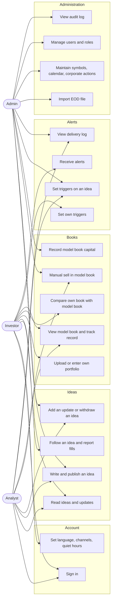
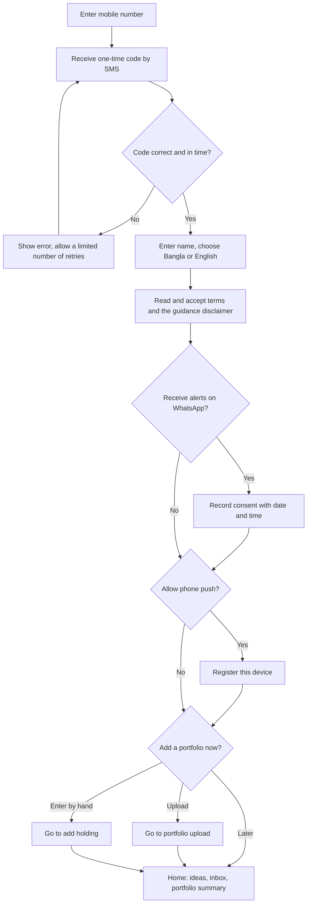
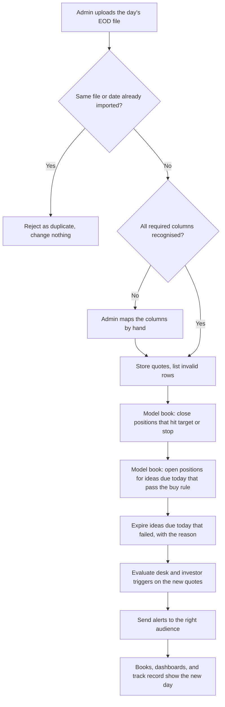
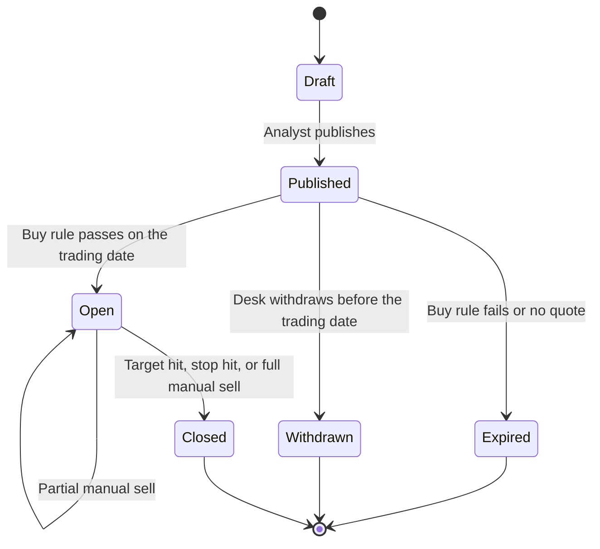
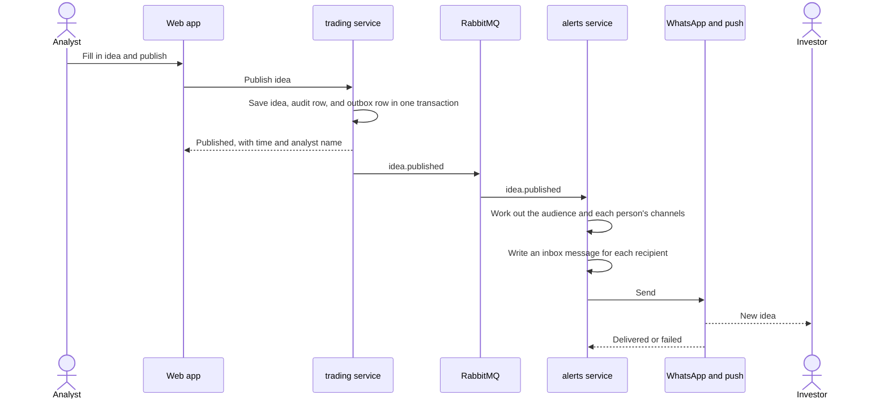
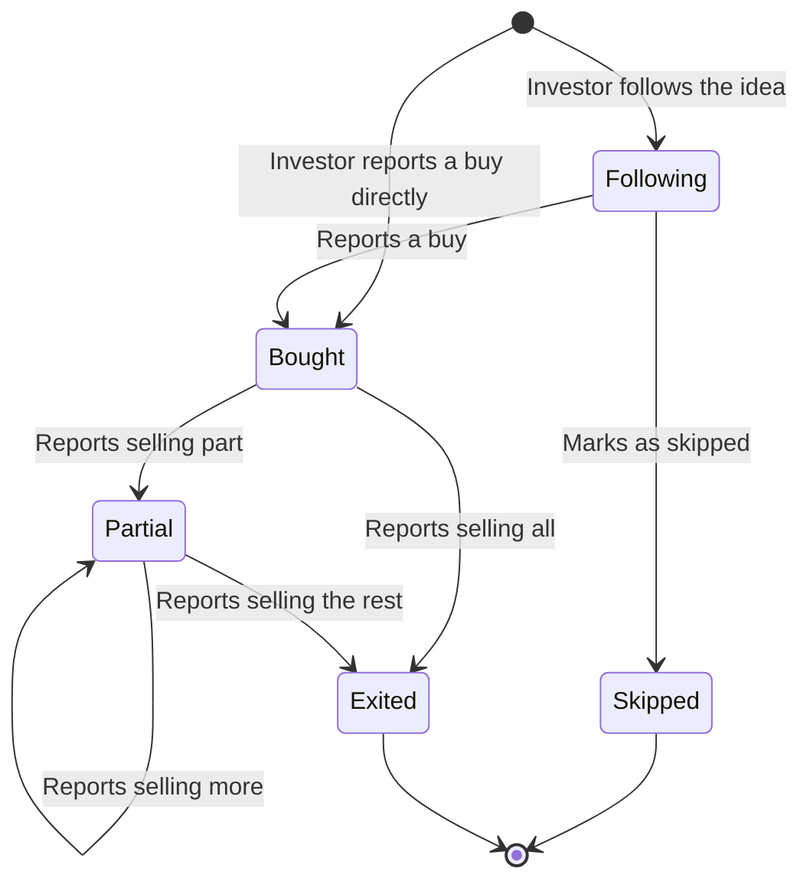
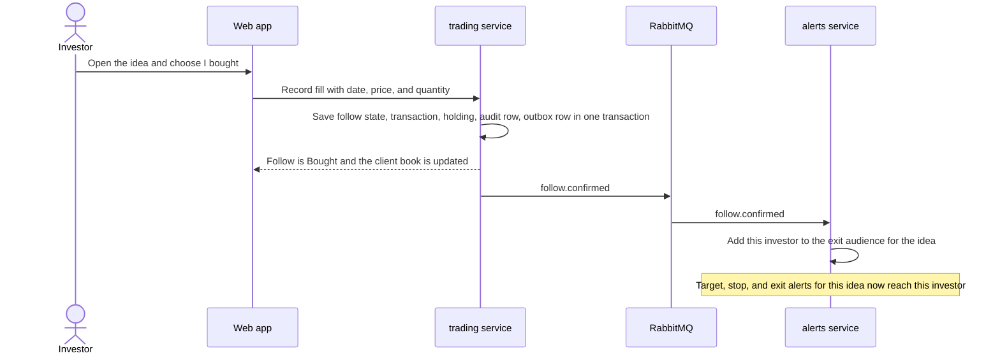
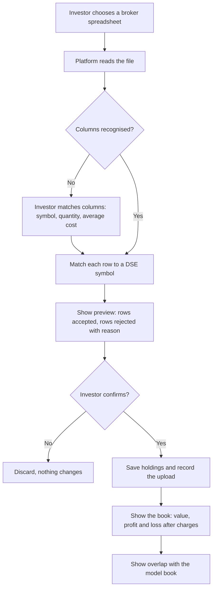
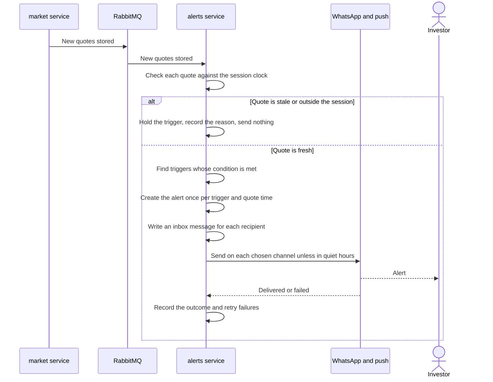
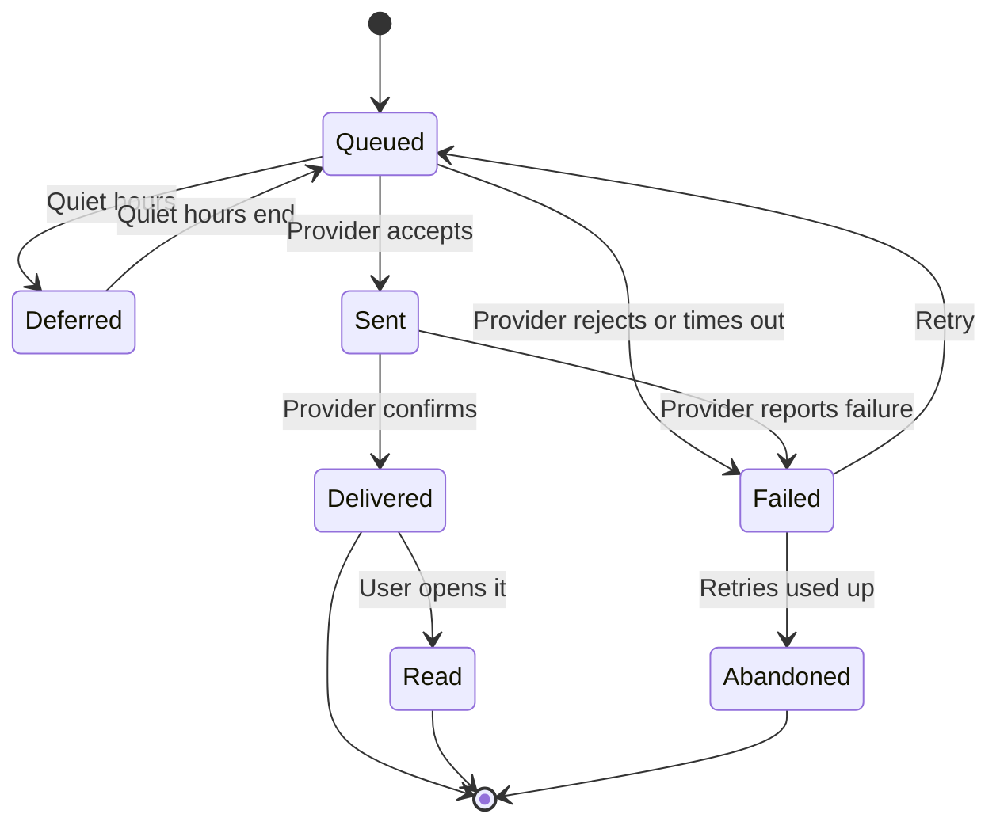

# 03. Users and journeys

Draft 0.1 · 15 November 2026 · For partner review

This document shows who uses the platform, what each role may do, and how the main tasks flow from start to finish. Each journey ends in acceptance checks a tester can run.

## Roles and what they do

An admin can do everything an analyst can. The diagram shows the admin's additional tasks and the shared publishing tasks.

### Permissions

| Action | Investor | Analyst | Admin |
|---|---|---|---|
| Read published ideas, updates, model book, and track record | Yes | Yes | Yes |
| Record a follow and fills on own account | Yes | No | No |
| Keep a client book: upload, edit, own triggers | Yes | No | No |
| See another investor's client book | No | See note | See note |
| Draft, publish, update, or withdraw an idea | No | Yes | Yes |
| Manual sell in the model book | No | Yes | Yes |
| Deposit or withdraw in the model book | No | No | Yes |
| Import EOD file. Maintain symbols, calendar, corporate actions | No | No | Yes |
| See how many investors followed, bought, or skipped an idea | No | Yes | Yes |
| See the alert delivery log | Own inbox only | Yes | Yes |
| Manage users and roles | No | No | Yes |
| Read the audit log | No | No | Yes |

Note: whether the desk can see an individual investor's book is an open decision (B-4). The recommendation is that a book is private unless the investor chooses to share it with the desk for guidance.

## Journey 1: An investor joins

## Journey 2: The desk's trading day

Until a live feed exists, the whole platform advances once per trading day, when the admin imports the EOD file.

## Journey 3: An idea from draft to close

### Life of an idea

Only a draft can be edited. From Published onward, the original values are fixed and every change is a dated update that investors can see.

### Publishing an idea

## Journey 4: An investor follows an idea

### States of a follow

### Confirming a buy

The fill updates the follow and the investor's book in one step, inside one service. That is why both live in the trading service.

## Journey 5: An investor loads their portfolio

The investor can also add, edit, or remove a holding by hand at any time.

The overlap view has three lists:

| List | Meaning |
|---|---|
| Both hold | Stocks in the client book that are open positions in the model book |
| Only you hold | Stocks in the client book that the model book does not hold |
| Only the model book holds | Open desk ideas the investor has not taken |

## Journey 6: A trigger becomes an alert

### Who receives which alert

| Alert | Recipients |
|---|---|
| New idea published | All active investors who have not muted the symbol. May change with the business model: see open decision B-1 |
| Idea update, such as a moved stop | Investors whose follow is Following, Bought, or Partial |
| Model book bought | Investors whose follow is Following |
| Near target or near stop | Investors whose follow is Bought or Partial |
| Model book sold at target or stop | Investors whose follow is Bought or Partial. Following investors see it in the inbox only |
| Idea expired or withdrawn | Investors whose follow is Following |
| An investor's own trigger | That investor |

An investor who skipped or exited an idea receives nothing further about it.

### Life of one delivery

A delivery is one alert, to one user, on one channel.

The inbox message is written before any WhatsApp or push send, so an abandoned delivery never means a lost alert.

## Acceptance checks

Each check is a test the team writes and a tester can repeat in staging.

### Accounts

| # | Check |
|---|---|
| AC-01 | An investor signs in with a mobile number and one-time code. A wrong or expired code is refused. Repeated code requests from one number are blocked |
| AC-02 | An investor cannot open a desk screen or call a desk action, even with a hand-typed address |

### Ideas and the model book

| # | Check |
|---|---|
| AC-03 | A published idea cannot be edited. An update appears as a dated note and the original values stay visible |
| AC-04 | On the trading date, a position opens only if the close is at or above the buy price and the volume is at or above the required volume. Otherwise the idea expires and the reason names the failed condition |
| AC-05 | A buy whose cost exceeds available cash is rejected with the amount needed |
| AC-06 | A second idea on a symbol with an open position is rejected |
| AC-07 | A position closes when the day's high reaches the target, or when the day's close is at or below the stop. Neither can happen on the entry day |
| AC-08 | Importing the same EOD file, or a second file for the same date, is refused and changes nothing |
| AC-09 | A partial manual sell reduces the quantity and records a trade with charges. A full sell closes the position |
| AC-10 | After every deposit, withdrawal, buy, and sell, available cash and equity match their definitions in the glossary |

### Client book

| # | Check |
|---|---|
| AC-11 | A broker file with unfamiliar column names can be mapped by hand. Accepted rows appear with the right quantity and average cost. Rejected rows are listed and not saved |
| AC-12 | A bonus issue or split changes quantity and average cost and leaves total cost unchanged. A rights issue adds quantity at the rights price |
| AC-13 | Confirming a buy sets the follow to Bought and changes only that investor's book |
| AC-14 | The overlap view puts every stock in the correct one of its three lists |
| AC-15 | An investor cannot read another investor's book through any screen or direct request |

### Alerts

| # | Check |
|---|---|
| AC-16 | A target or stop alert reaches investors whose follow is Bought or Partial, and no one whose follow is Skipped or Exited |
| AC-17 | The same trigger and quote time never produce two alerts to the same user on the same channel |
| AC-18 | A stale or off-session quote fires no trigger, and the hold is recorded |
| AC-19 | WhatsApp is sent only to investors who gave consent. Withdrawing consent stops it immediately |
| AC-20 | A failed WhatsApp send is retried, appears as failed in the delivery log, and the inbox still holds the message |
| AC-21 | In quiet hours no WhatsApp or push is sent. The inbox receives the message at once |

### Whole platform

| # | Check |
|---|---|
| AC-22 | Every change to money, a position, a holding, or an idea has an audit entry with the user and the time |
| AC-23 | Every screen is available in Bangla and English |
