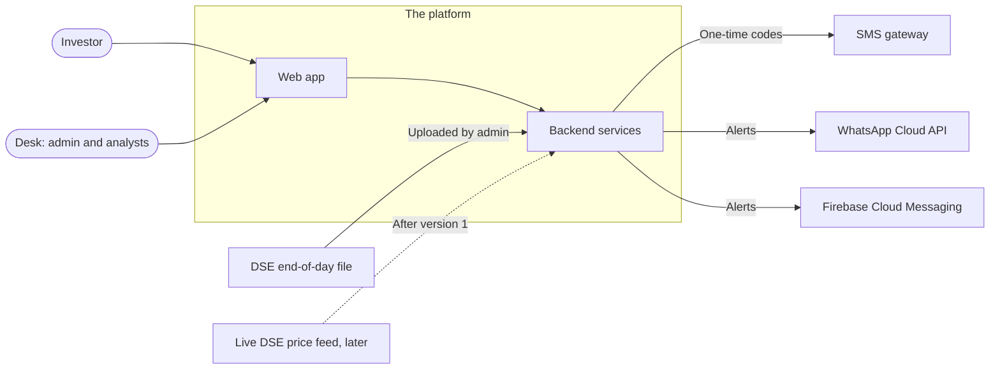
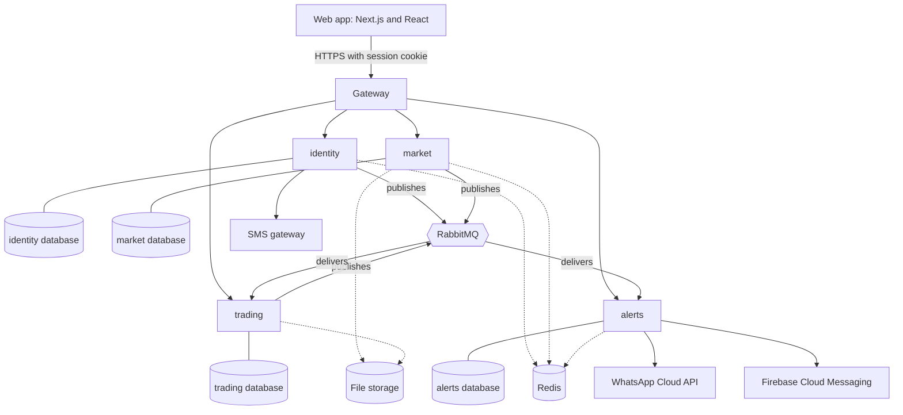
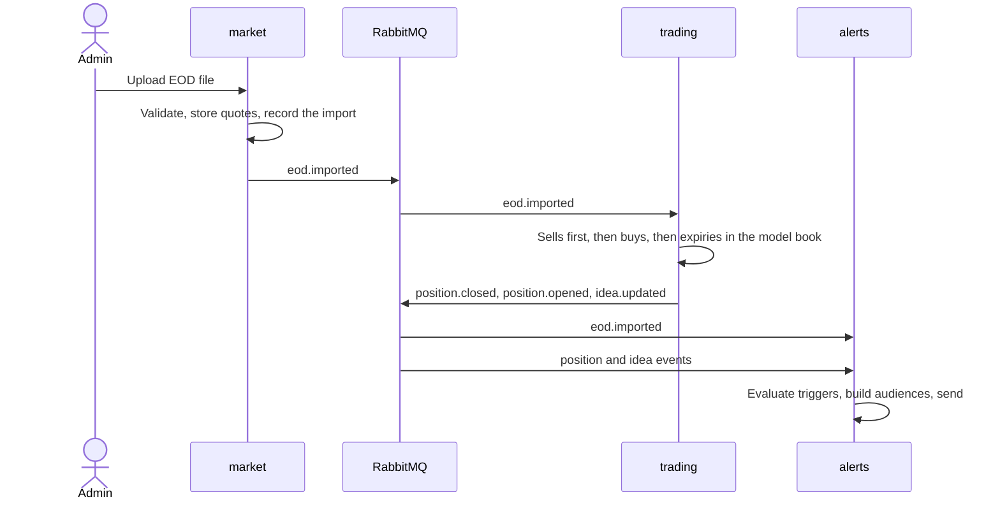

# 04. Architecture

Draft 0.1 · 15 November 2026 · For partner review

## The platform and what it connects to



The platform has no connection to any broker. Trades reach it only when a user records them.

## Services

The backend is four services behind one gateway. Each service has its own database, and no service reads another's database.



| Service | Owns | Why it is separate |
|---|---|---|
| identity | Users, roles, one-time codes, staff passwords, sessions, WhatsApp consent, registered devices | Sign-in and personal data change for different reasons than trading, and need the tightest access |
| market | DSE symbols, trading calendar, EOD quotes, live quotes later, corporate actions | It is the only part that changes when the live feed arrives |
| trading | Ideas and updates, the model book, client books, uploads, follows, fills, cash, charges, track record | An idea, a position, a holding, and a fill are one business action and must be saved together |
| alerts | Triggers, alert audience, inbox, deliveries, notification preferences | WhatsApp and push are slow and fail. Their retries must not hold up publishing an idea |
| gateway | Routing, token check, request id. No business rules | One address for the web app, and one place to check who is calling |

### Why trading is one service

When an investor confirms a buy, the follow state, a transaction, the holding, and an audit entry all change. If ideas and portfolios were separate services, that single tap would have to update two databases and could leave them disagreeing. Keeping them together makes it one database transaction.

## How services communicate

Two kinds of communication, used for different things.

| Kind | Used for | Example |
|---|---|---|
| Request through the gateway (REST) | Something a user is waiting for | Publish an idea, upload a portfolio, record a fill |
| Event on RabbitMQ | A fact that has already happened | A new day's quotes were stored, an idea was published |

### Events

| Event | Published by | Read by | Meaning |
|---|---|---|---|
| `user.registered` | identity | alerts | A new user exists, with role and language |
| `user.contact-updated` | identity | alerts | Mobile number, consent, or devices changed |
| `eod.imported` | market | trading, alerts | All quotes for one trading day are stored |
| `quote.updated` | market | trading, alerts | One live quote arrived. Not used until the live feed exists |
| `corporate-action.declared` | market | trading | A bonus, rights issue, or split takes effect |
| `idea.published` | trading | alerts | A new idea is visible to investors |
| `idea.updated` | trading | alerts | An update was added, or the idea was withdrawn or expired |
| `position.opened` | trading | alerts | The model book bought |
| `position.closed` | trading | alerts | The model book sold, fully or partly, with the reason |
| `follow.confirmed` | trading | alerts | An investor's follow state changed |
| `holding.changed` | trading | alerts | An investor's holding changed, for triggers based on entry price |
| `notification.sent` | alerts | none in version 1 | A delivery succeeded |
| `notification.failed` | alerts | none in version 1 | A delivery was abandoned |

The alerts service keeps its own copy of what it needs from these events: who each user is, how to reach them, and who is following or holding what. It never asks the trading service at send time, so alerts continue even if the trading service is restarting.

### Never losing an event

A service writes its change and a record of the event to its own database in one transaction. This record is the outbox. A separate publisher sends outbox rows to RabbitMQ and marks them sent. If the service stops between the two steps, the event is sent when it restarts. A published idea therefore always produces its alert, and an alert never refers to an idea that was not saved.

Because an event can arrive twice, every reader ignores an event it has already processed.

### The trading day across services



## Rules that apply everywhere

| Subject | Rule |
|---|---|
| Money and prices | Stored as exact decimals: `NUMERIC` in the database and `BigDecimal` in Java. Floating point is never used for money |
| Time | Stored in UTC. Shown in Dhaka time. Trading dates are calendar dates in Dhaka |
| Session clock | Trading days, hours, and holidays are data held by the market service, so changes such as Ramadan hours need no code change |
| Stale quotes | A quote older than the session clock allows never fires a trigger |
| Ideas | Insert-only after publication. Changes are new update rows |
| Audit | Every change to money, a position, a holding, or an idea writes an audit entry in the same transaction |
| Duplicates | One delivery per trigger, quote time, user, and channel |
| Files | Uploaded spreadsheets go to file storage. Only a reference travels in an event |
| Identifiers across services | A service stores another service's id as a plain value. There are no database links between services |

## Sign-in and sessions

- An investor signs in with a mobile number and a one-time code sent by SMS. Codes are short-lived and held in Redis.
- Staff sign in with a username and password.
- The identity service issues a short-lived access token and a longer-lived refresh token.
- The web app's server holds both in cookies that browser scripts cannot read, and calls the gateway. The browser never calls a service directly.
- The gateway checks the token on every request. Each service checks the role again for its own actions.

## Technology

### Backend

| Purpose | Choice |
|---|---|
| Language and framework | Java 21, Spring Boot 3 |
| Gateway | Spring Cloud Gateway |
| Web and validation | Spring Web, Bean Validation |
| Security | Spring Security as an OAuth2 resource server |
| Database access | Spring Data JPA |
| Database changes | Flyway, one history per service |
| API description | springdoc-openapi, one specification per service |
| Messaging | Spring AMQP with RabbitMQ |
| External call protection | Resilience4j around WhatsApp, Firebase, and SMS |
| Spreadsheet reading | Apache POI for Excel, a CSV parser for text files |
| Tests | JUnit 5, Testcontainers |

### Data and infrastructure

| Purpose | Choice |
|---|---|
| Database | PostgreSQL 16. One server to start, one database per service |
| Cache and short-lived data | Redis: one-time codes, latest quote, alert de-duplication |
| Message broker | RabbitMQ |
| File storage | S3-compatible storage, such as Cloudflare R2 |
| Phone push | Firebase Cloud Messaging |
| WhatsApp | WhatsApp Cloud API from Meta, using approved message templates |
| SMS | A Bangladesh SMS gateway. Provider not chosen |
| Packaging | Docker Compose |
| Hosting | One virtual server in Singapore or Mumbai to start |
| Observability | Structured JSON logs with a request id, OpenTelemetry traces, Prometheus metrics |

### Web app

| Purpose | Choice |
|---|---|
| Framework | Next.js with the App Router, React, TypeScript |
| Styling | Tailwind CSS with the existing design tokens |
| Server data | TanStack Query |
| Tables | TanStack Table. TanStack Virtual where a list becomes long |
| Forms | TanStack Form with Zod validation |
| API client | Generated from each service's OpenAPI specification |
| Languages | next-intl, Bangla and English |
| Charts | TradingView Lightweight Charts |
| Browser tests | Playwright |

## Repository layout

```text
platform/
  services/
    identity/
    market/
    trading/
    alerts/
    gateway/
  web/                  Next.js app
  contracts/openapi/    API specifications generated from the services
  libs/common/          Error format, event envelope, request id, money type
  infra/                Docker Compose and server setup
  docs/                 These documents and the decision records
```

The shared library holds only cross-cutting pieces. Business records such as an idea or a holding are defined only in the service that owns them.

## Environments

| Environment | Purpose | External services |
|---|---|---|
| Local | Development on one machine with Docker Compose | Fake SMS, WhatsApp, and push senders |
| Staging | Same layout as production, used for demonstrations and acceptance checks | Fake senders and a recorded EOD file, so alerts can be rehearsed |
| Production | Real users | Real SMS, WhatsApp, and Firebase accounts |

Staging and production never share passwords or keys. Secrets are supplied by the host environment and are never committed to the repository.

## When the live feed arrives

The market service gains a second source of quotes and begins publishing `quote.updated`. The trading and alerts services already read quotes through events and need no rule changes. What does change is volume: quotes arrive continuously, so trigger evaluation moves from once a day to continuous, and the hosting is reviewed at that point.
