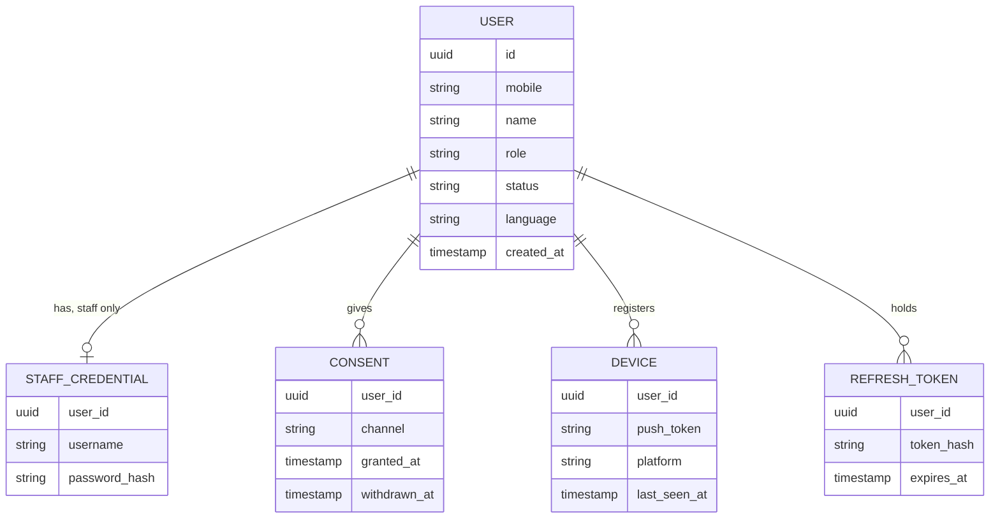
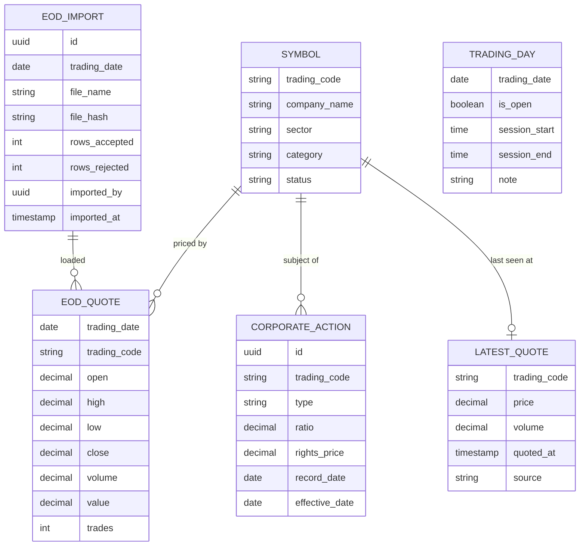
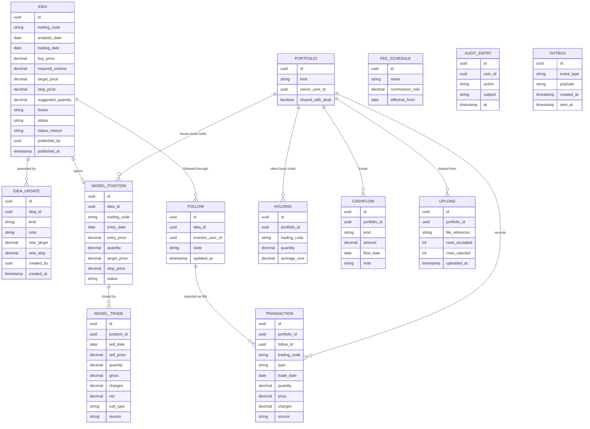
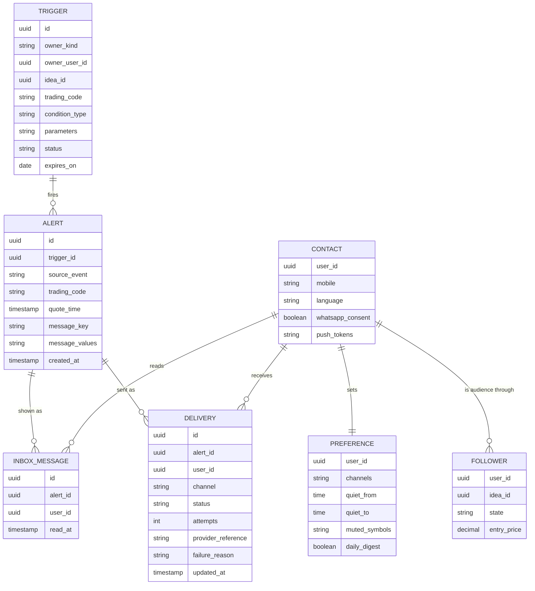

# 05. Data model

Draft 0.1 · 15 November 2026 · For partner review

This is the logical model: the records each service keeps and how they relate. It shows the important fields, not every column. Exact tables are designed when the slice that needs them is built.

Each service has its own database. Where a record refers to something in another service, such as a user id inside the trading service, it stores the id as a plain value with no database link.

## Rules for all records

| Subject | Rule |
|---|---|
| Money, prices, quantities | Exact decimals. Never floating point |
| Timestamps | Stored in UTC |
| Trading dates | Calendar dates in Dhaka |
| Ideas, trades, transactions, cashflows, audit entries | Insert-only. A correction is a new record, never an overwrite |
| Deleting | Financial records are never deleted. A user account is deactivated, not removed. Retention is open decision B-8 |

## identity

One-time codes are kept in Redis for a few minutes and never stored in the database.

## market

There is one EOD quote per symbol per trading date, and one import per trading date. The file hash blocks the same file from being loaded twice. `TRADING_DAY` is the session clock: weekends, holidays, and changed hours are rows, not code.

## trading

How to read this:

- There is one house portfolio and one client portfolio per investor. `kind` says which.
- The house book is made of model positions, each opened by exactly one idea. A position's current target and stop start as the idea's and change only through an idea update.
- A client book is made of holdings. A holding is the running total of that investor's transactions in one symbol.
- A fill is a transaction that carries a follow id. A transaction with no follow id came from an upload, a manual entry, or a corporate action. `source` records which.
- `FOLLOW` has one row per investor per idea.
- `shared_with_desk` exists only if open decision B-4 is answered yes.
- The track record is calculated from model trades and cashflows. It is not stored separately.

## alerts

How to read this:

- `CONTACT` and `FOLLOWER` are read models. They are copies of facts owned by identity and trading, kept current from events.
- An alert comes either from a trigger firing or directly from an event such as `idea.published`. In the second case `trigger_id` is empty and `source_event` names the event.
- An alert stores a message key and its values, not finished text, so the same alert can be shown in Bangla or English.
- A delivery is unique for one alert, one user, and one channel. An alert is unique for one trigger and one quote time. Together these prevent duplicates.

## From the proof of concept to the new model

| Proof of concept table | Becomes |
|---|---|
| `users` | `USER` and `STAFF_CREDENTIAL` in identity |
| `watchlist` | `IDEA` in trading |
| `positions` | `MODEL_POSITION` in trading |
| `trades` | `MODEL_TRADE` in trading |
| `signals` | Calculated from `position.opened` and `position.closed`. Not a table |
| `cashflows` | `CASHFLOW` on the house portfolio |
| `eod_data` | `EOD_QUOTE` in market |
| `eod_uploads` | `EOD_IMPORT` in market |
| `audit` | `AUDIT_ENTRY` in each service |

Whether the proof of concept's existing trades are loaded into the new model book as its opening history is open decision T-6.
