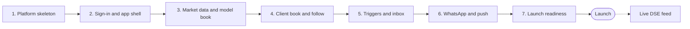

# 08. Delivery plan

Draft 0.1 · 15 November 2026 · For partner review

This plan gives the order of work and the standard each piece must meet. It gives no dates or costs. Those depend on the team and on the open decisions, and belong in the partners' plan.

## How the work is run

- The build proceeds in slices. A slice is complete from database to screen, deployed to staging, and demonstrated.
- Work is planned in two-week increments. Each increment ends with a staging demonstration to the partners.
- Every change goes through review and an automated build before it is merged. The main branch can always be deployed to staging.
- A decision that changes a document in this folder is made by changing the document in the same review.

## Roles on the team

One person may fill more than one role. The responsibilities remain separate.

| Role | Responsible for |
|---|---|
| Product owner | Scope, priorities, the open decisions, and accepting each slice |
| Trading lead | The correctness of trading rules and corporate actions. A partner from the desk |
| Backend engineer | The services, databases, and events |
| Frontend engineer | The web app |
| Quality engineer | Acceptance checks, browser tests, and the staging sign-off |
| Operations | Environments, backups, monitoring, and releases |

## Build order

### Slice 1. Platform skeleton

| | |
|---|---|
| Builds | The repository. Empty identity, market, trading, alerts, and gateway services. PostgreSQL, Redis, and RabbitMQ in Docker Compose. Automated build for every service and the web app. Request id and structured logs across the gateway and services. The outbox publisher. A staging server |
| Done when | One command starts the whole platform locally. A request through the gateway can be followed by its id in every service's log. A test event crosses RabbitMQ from one service to another. Staging runs the same build |
| Needs | E-1, E-2 |

### Slice 2. Sign-in and app shell

| | |
|---|---|
| Builds | Investor sign-in by mobile and one-time code. Staff sign-in by password. Roles. Session cookies through the web app. The desk layout and the investor layout, in Bangla and English, with the design tokens applied. User management for admins |
| Done when | An investor, an analyst, and an admin each sign in on staging and see their own navigation. Checks AC-01 and AC-02 pass |
| Needs | D-4 for real SMS. A fake sender is enough for staging |

### Slice 3. Market data and model book

| | |
|---|---|
| Builds | Symbols and the trading calendar. EOD import with duplicate detection and column mapping. Ideas: draft, publish, update, withdraw. The model book rules: buy, cash check, target, stop, expiry, manual sell, capital. The desk dashboard, model book, trade history, and track record |
| Done when | The same EOD files and ideas given to the proof of concept and to the platform produce the same positions, trades, and cash, apart from differences the partners have decided. Checks AC-03 to AC-10 pass |
| Needs | T-1, T-2, T-3, T-6, T-7, T-9, B-5, D-1 |

This slice replaces the proof of concept for the desk's daily work.

### Slice 4. Client book and follow

| | |
|---|---|
| Builds | Investor idea list and idea page. Follow states and fills. Client book by upload and by hand. Charges. Corporate actions in both books. The overlap view |
| Done when | An investor on staging uploads a book, confirms a buy on an idea, and sees the holding, the profit and loss, and the overlap. A bonus issue adjusts both books. Checks AC-11 to AC-15 pass |
| Needs | B-4, B-6, T-4, T-5, D-5 |

### Slice 5. Triggers and inbox

| | |
|---|---|
| Builds | The alerts service's read models. Desk triggers on ideas and investor triggers on any symbol. Evaluation on each EOD import. Audience rules. The inbox. Notification preferences. The stale-quote guard |
| Done when | An EOD import on staging produces the right inbox messages for the right investors, once each. Checks AC-16 to AC-18 pass |
| Needs | B-1 |

### Slice 6. WhatsApp and push

| | |
|---|---|
| Builds | WhatsApp sending with approved templates and consent. Phone push. Retries. Quiet hours. The delivery log for the desk |
| Done when | A real phone receives a WhatsApp alert and a push alert from staging. A forced failure shows in the delivery log and the inbox still has the message. Checks AC-19 to AC-21 pass |
| Needs | D-3. Template approval takes time and should be started during slice 3 |

### Slice 7. Launch readiness

| | |
|---|---|
| Builds | Nightly backups and a restore drill. Monitoring and team alerts. Rate limits. The disclaimer and terms. The operations runbook. A security review. A full acceptance run in Bangla and English |
| Done when | A restore from backup has been performed and timed. Every acceptance check passes on staging. The partners sign off the legal items |
| Needs | B-2, B-8, E-4 |

### After launch: live DSE feed

The market service gains a live source and publishes each quote. Triggers begin to be evaluated continuously. The trading rules for target and stop under live prices must be settled first (T-8). Hosting is reviewed for the higher load. Needs D-2.

## Definition of done

A change is finished when all of these are true.

| # | Condition |
|---|---|
| 1 | The behaviour is covered by an automated test. A trading rule has a unit test |
| 2 | Money uses exact decimals throughout |
| 3 | A change to money, a position, a holding, or an idea writes an audit entry in the same transaction |
| 4 | Database changes are in a Flyway migration that only moves forward |
| 5 | The API specification is regenerated and the web app's client is rebuilt from it |
| 6 | The screen handles loading, empty, and error states, in Bangla and English |
| 7 | The change is reviewed and the automated build passes |
| 8 | It has been exercised on staging, including from the other role's side where one exists |

## Testing

| Layer | What it proves | When it runs |
|---|---|---|
| Unit tests on trading rules | Buy, volume, cash, target, stop, expiry, charges, bonus, rights, split | Every build. A failure blocks release |
| Service tests with a real database and broker | Migrations, the outbox, follow confirmation, duplicate alerts rejected, ownership checks | Every build |
| Contract check | The web app's generated client matches the services | Every build |
| Browser tests | Sign in, publish an idea, upload a book, confirm a fill, read the inbox | Against staging before each release |
| Proof of concept comparison | The model book rules reproduce the proof of concept's results | During slice 3 |
| Acceptance run | Every check in [Users and journeys](03-users-and-journeys.md) | Before launch and before each major release |

## Releases

- A release is a tagged build that has already run on staging.
- Database migrations are applied before the new services start and never undo an earlier migration.
- A release that affects trading rules is approved by the trading lead.
- Production changes during DSE trading hours are avoided once the live feed exists.

## What is produced along the way

| Document | Produced |
|---|---|
| API specification for each service | Generated from the code from slice 2 onward |
| Wireframes for a slice's screens | Just before that slice starts |
| WhatsApp message templates | Drafted in slice 3, submitted for approval before slice 6 |
| Operations runbook | Slice 7, from real staging incidents |
| Decision log entries | Whenever a decision is made or an open decision is closed |
