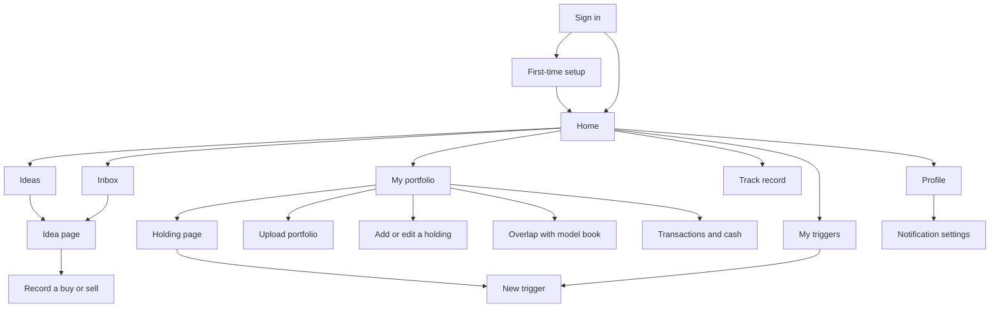
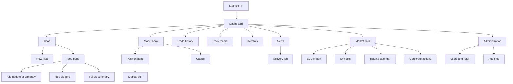

# 09. Screen map

Draft 0.1 · 15 November 2026 · For partner review

This lists every version 1 screen, who sees it, and which build slice delivers it. It is a map, not a design. Wireframes for a slice are drawn just before that slice starts.

One web app serves both groups. After sign-in, a user lands in the investor area or the desk area according to their role.

## Investor area

| Screen | What the investor does there | Slice |
|---|---|---|
| Sign in | Enters mobile number and one-time code | 2 |
| First-time setup | Name, language, terms and disclaimer, WhatsApp consent, push permission | 2 |
| Home | Sees today's ideas, unread alerts, and a portfolio summary | 2, filled in by 4 and 5 |
| Ideas | Browses open and past ideas, filtered by status and by own follow state | 4 |
| Idea page | Reads the reason, levels, price chart, and updates. Follows, skips, or records a fill | 4 |
| Record a buy or sell | Enters date, price, quantity, and charges | 4 |
| My portfolio | Sees holdings with value and profit and loss after charges, cash, and equity | 4 |
| Holding page | Sees one stock's transactions, corporate actions, and triggers | 4 |
| Upload portfolio | Chooses a file, maps columns, previews, confirms | 4 |
| Add or edit a holding | Enters a holding by hand | 4 |
| Overlap with model book | Compares own book with the model book in three lists | 4 |
| Transactions and cash | Sees every transaction, deposit, and withdrawal | 4 |
| My triggers | Lists own triggers and their state | 5 |
| New trigger | Chooses a symbol, a condition, and channels | 5 |
| Inbox | Reads alerts and opens the idea or holding each refers to | 5 |
| Track record | Sees the model book's open positions, closed trades, and results | 3 for the desk, shown to investors in 4 |
| Profile | Name, language, mobile number, sign out | 2 |
| Notification settings | Channels, quiet hours, muted symbols, daily digest, WhatsApp consent | 5 and 6 |

## Desk area

| Screen | What the desk does there | Role | Slice |
|---|---|---|---|
| Staff sign in | Username and password | Analyst, admin | 2 |
| Dashboard | Sees open positions, today's signals, cash, equity, results, and the last EOD import | Analyst, admin | 3 |
| Ideas | Lists drafts, published, open, closed, expired, and withdrawn ideas | Analyst, admin | 3 |
| New idea | Writes a draft and publishes it | Analyst, admin | 3 |
| Idea page | Sees the original idea, its updates, and its position | Analyst, admin | 3 |
| Add update or withdraw | Adds a dated note, moves a target or stop, or withdraws | Analyst, admin | 3 |
| Idea triggers | Sets near-target and near-stop triggers for followers | Analyst, admin | 5 |
| Follow summary | Sees how many investors followed, bought, skipped, and exited | Analyst, admin | 4 |
| Model book | Sees open positions with value and profit and loss | Analyst, admin | 3 |
| Position page | Sees one position's entry, levels, and trades | Analyst, admin | 3 |
| Manual sell | Sells all or part with price, date, and charges | Analyst, admin | 3 |
| Capital | Records deposits and withdrawals. Sees available cash and equity | Admin | 3 |
| Trade history | Filters closed trades by symbol, date, result, and exit type. Exports | Analyst, admin | 3 |
| Track record | Win rate, average gain and loss, holding time, monthly results, drawdown | Analyst, admin | 3 |
| Investors | Lists investors with sign-up date, follow activity, and channel status | Admin | 4 |
| Alerts | Sees alerts sent today and any held for a stale quote | Analyst, admin | 5 |
| Delivery log | Sees each delivery's channel, state, attempts, and failure reason | Analyst, admin | 6 |
| EOD import | Uploads the day's file, maps columns, sees the result and past imports | Admin | 3 |
| Symbols | Maintains the DSE symbol list | Admin | 3 |
| Trading calendar | Maintains trading days, hours, and holidays | Admin | 3 |
| Corporate actions | Enters bonus, rights, and split with dates and ratios | Admin | 4 |
| Users and roles | Creates staff accounts, changes roles, deactivates users | Admin | 2 |
| Audit log | Searches who changed what and when | Admin | 3 |

## Standards for every screen

| Subject | Standard |
|---|---|
| Look | The existing design system in `design-system/sany-stock-tracker/MASTER.md`: dark background, green for gains, red for losses, Fira Code for headings and figures, Fira Sans for text, dense dashboard spacing. A light theme is available |
| Phone | Every investor screen works on a phone. Desk screens work on a phone but are designed for a desktop |
| Language | Bangla and English on every screen, chosen in the profile |
| Numbers | Taka amounts with thousands separators and two decimals. Gains and losses carry a sign and a colour, never colour alone |
| States | Every screen has a loading state, an empty state with a next step, and an error state with a way to retry |
| Tables | Sortable and filterable. Long tables page on the server |
| Time | Dates and times are shown in Dhaka time. Every price shows the date or time it is from |
| Disclaimer | Every idea page states that the idea is guidance and that the platform does not execute trades |
| Accessibility | Usable by keyboard, with visible focus, sufficient contrast, and touch targets of at least 44 pixels |
